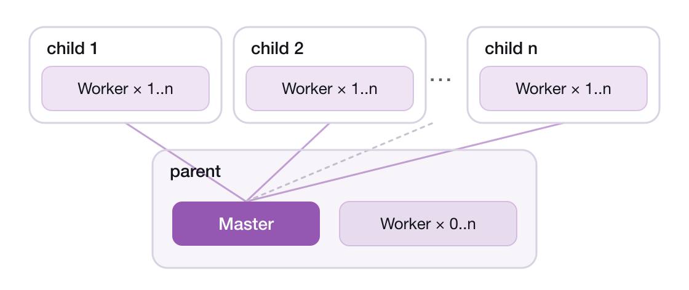

<!-- markdownlint-disable MD033 MD013 MD041 -->
<p align="center">
  <picture>
    <source
      media="(prefers-color-scheme: dark)"
      srcset="docs/src/assets/social/readme-dark-static.png">
    
  </picture>
</p>
<!-- markdownlint-enable MD033 MD013 MD041 -->

[English](README.md) | [简体中文](README.zh.md) | [日本語](README.ja.md)

<!-- markdownlint-disable MD013 -->
[](https://github.com/yamanori99/DistSSHKit.jl/actions/workflows/CI.yml)
[](https://codecov.io/gh/yamanori99/DistSSHKit.jl)
[](https://yamanori99.github.io/DistSSHKit.jl/stable/)
[](https://yamanori99.github.io/DistSSHKit.jl/dev/)
[](https://yamanori99.github.io/DistSSHKit.jl/stable/requirements/)
[](https://github.com/fredrikekre/Runic.jl)
[](LICENSE)
[](https://github.com/yamanori99/DistSSHKit.jl/discussions)
<!-- markdownlint-enable MD013 -->

## DistSSHKit

DistSSHKitは、SSHを介して複数のマシン上でJuliaによる計算を実行するツールキットである。
ワークステーション2台でも、研究室のより多くのマシンでも、同じように使える。
対応環境は **macOS、Linux、WSL2 Ubuntu** である (ネイティブ Windows は対象外)。

`pkg> add DistSSHKit` でインストールし、1つのコマンド
`julia -m DistSSHKit` から使う。
[DistSSHRun](https://github.com/yamanori99/DistSSHRun.jl) と
[DistSSHQueue](https://github.com/yamanori99/DistSSHQueue.jl) はそれに同梱され、
どちらもそのコマンドから使う。

ジョブが走る場所は、次の2つである。

- **このマシン。** ここでジョブを始める。終わるまで SSH 接続は開いたままである。
  コマンドは `go`、`ride`、`drive`、`plan`、
  `size`、`pool`、`demo`、`progress` である。
- **キューホスト。** 常時稼働のマシンである。ジョブをそこに置き、1件ずつ走らせる。
  同じパッケージをそのマシンにも入れる。ノートPCの接続が切れても、すでに置いてあるジョブは止まらない。
  コマンドは `submit`、`status`、`watch`、`cancel`、`fetch`、`serve` である。
  `qhost` はそのマシンを指す。

**ホストの準備**は、このマシンから始める場合とキューホストを使う場合の両方に共通する。
`setup` は SSH 先を準備する。`up` は各マシンの Julia チャネル (バージョン系列) を揃える。
どちらで始める場合も、その前に行う。

## インストール

JuliaのREPLで `]` を押してPkgモードに入り、次を実行する。

```julia
pkg> add DistSSHKit
```

同じことは `Pkg` API でもできる。

```julia
julia> import Pkg; Pkg.add("DistSSHKit")
```

実行を始めるマシンには **`ssh`** と **`rsync`** も必要である。
git でデプロイする場合は、さらに **`git`** も必要である。
これらは Julia のパッケージとは別であり、`pkg> add` では入らない。
要件の一覧は
[Requirements](https://yamanori99.github.io/DistSSHKit.jl/stable/requirements/)
を参照する。

それ以外は
**[ドキュメント](https://yamanori99.github.io/DistSSHKit.jl/stable/)**
を参照する。

## 使用方法

### 基本用語

- **ホスト** — 計算を行うマシン。`parent` や `child:user@hostname` のようなトークンで指定する。
- **プロセス** — 実行中の `julia` 1つ。それぞれが自分のメモリを持ち、OS上では独立して動く。
  (1回の実行では、1台のマシン上でも複数の `julia` プロセスを起動して仕事を並列に行う。基盤は Distributed.jl である。)
- **マスター** — 実行が始まるマシン上のプロセス。`go` ではスロットの割り当てを計画し、`drive` ではワーカーに仕事を渡して結果を集める。
  手元で `go` / `drive` するときはこのマシン、ジョブを置いたときはキューホストである。
- **ワーカー** — マスターから仕事を受け取って実行するプロセス。

例えば手元のマシンで `go` や `drive` を実行すると、そのマシンがジョブを始めた側になる。
各マシンではワーカーを複数動かせる (このマシンでは 0 でもよい)。リモートマシンは必要なだけ追加できる。

<!-- markdownlint-disable MD033 MD013 -->
<p align="center">
  <picture>
    <source
      media="(prefers-color-scheme: dark)"
      srcset="docs/src/assets/diagram/topology-dark.svg">
    <source
      media="(prefers-color-scheme: light)"
      srcset="docs/src/assets/diagram/topology.svg">
    
  </picture>
</p>
<!-- markdownlint-enable MD033 MD013 -->

図は **drive** である。このマシンにマスターが1つあり、各ホストにワーカーがいる。
**go** も同じホストトークンを使うが、マスターとワーカーの関係はない。各ホストがスクリプトを自分で実行する。

```text
parent                 # このマシン
parent:2               # このマシンで2つ
child:user@hostname    # SSH の child (user@host、IP、または Host エイリアス)
child:user@hostname:4  # その child で4つ
```

SSH先の台数に上限はない。ただし台数が増えるほど、SSH接続と配置に時間がかかる。まずは少数から試し、そこから増やすとよい。

SSH先を使う前に、次を満たしていること。

- 実行が始まるマシンから、パスワードなしで SSH ログインできること。
- Julia が入っていて、そのマシンと **メジャー.マイナーのバージョンが同じ**であること
  (`setup --check` が確認する)。チャネルは先に `up` で揃える。

詳細は
[Requirements](https://yamanori99.github.io/DistSSHKit.jl/stable/requirements/)
を参照する。

### このマシン: go、ride、drive

スクリプトの実行方法は3つある。

- **go** — 各ホストが `.jl` ファイルを、最初から最後までそのまま実行する。
- **ride** — DistSSHKit が、互いに独立な `map`、filter、内包表記、添字付き `for` の処理を分割する
  (実験的機能。parent または SSH ワーカーで動く)。
- **drive** — 1つのマスターがワーカーへ仕事を配る (Distributed.jl が基盤)。

### 事前確認: plan (ファイル) と pool (ホスト)

- **plan** — `.jl` ファイルを調べ、go、ride、drive のどれにするかを提案する。
  ディスクからの読み取りと構文解析しかしないので、bang は付かず、SSH もしない。
  任意のスロット見積もりでは `size!` を呼べる。
- **pool** / **pool!** — 列挙したホストのコア数と RAM を報告する。
  SSH を使うので bang が付く。RSS は報告しない。
  届かないホストも一覧に残り、`ok=false` となる。

**size** / **size!** は占有状況 (RSS に基づく `WorkerPlan`) を報告する。
CLI の `size` は計画を表示する。
go、drive、ride では、列挙した各トークンに `:N` が必要である
(トークンが無ければ parent のスロットが1つになる)。
例外は `go --repeat` で、列挙したホストの `:N` を省ける。そのホストの pool には上限が付かない。
いずれもダッシュボードではない。

`go` だけでも十分役に立つ。よくある進め方は、まず `go` で単独実行を確かめ、必要になってから `drive` と Distributed.jl に移ることである。
`plan` がすぐに `ride` を提案することもある。

### 操作方法

- **CLI** — ターミナルから DistSSHKit を実行する。
  例: `julia --project=. -m DistSSHKit go child:user@host1:1 script.jl`。
  コマンドのフラグ: `julia -m DistSSHKit help go`。
  手軽に試すときや、シェルスクリプトに組み込むときに向いている。
- **Julia** — 自分の Julia コード (スクリプト、REPL、別のパッケージ) から関数を呼ぶ。
  `setup!`、`go!`、`drive!`、`plan` (bang は付かない)、`pool!`、および他の `!` 関数である。

CLI のフラグは Julia API と1対1に対応する。
例えば `setup --rsync` は `setup!(session, :rsync)` に相当する。
`demo install with_kit` と `demo install without_kit` のあと、例は
`distsshkit_demos/with_kit/pipeline_square.jl` と
`distsshkit_demos/without_kit/pipeline_pi.jl` を参照する。

どちらも行うことは同じで、呼び方だけが異なる。最初は CLI がわかりやすい。

### 事前準備

通常はスクリプトの前に `setup` を実行する。プロジェクトを配置し、依存を入れる。
1回の呼び出しで指定する配置または初期化は1つだけである。
リモートが空、または無いときは、`go --rsync` または `drive --rsync` で、プロジェクトのコピーと instantiate を一度に行える
(通常の `go` と `drive` は、リモートが準備済みであることを前提とする)。

- 初回の配置: `--rsync` (ローカルのツリーをそのまま送る) または
  `--clone` (リポジトリを `git clone` する) のどちらか一方であり、両方ではない。
- 依存: `--instantiate` (リモートで `Pkg.instantiate` を実行する)。
- 更新 (再配置): `--sync` (`git push` のあと、各リモートで `pull`)、
  `--pull` (`pull` のみ。push はしない)、または `--rsync` をもう一度。
- その他のモード:
  - `--check` (SSH、Julia、依存を確認する)
  - `--cleanup` (残っているワーカープロセスを止める)
  - `--prune` (`.distsshkit` の go、drive、setup、runs のリーフを消す。配置したツリーは残る)
  - `--delete` (リモートのプロジェクトディレクトリを消す。破壊的である)

`--rsync`、`--clone`、`--sync`、`--pull`、`up`、`up update` は、実行前に確認を求める。
スクリプトなどから非対話で実行するには `-y` または `--yes` を付ける。
`--delete` と `--prune` は `delete` または `prune` の入力を求める。
`-y` と `DISTSSHKIT_YES` は、いまもその確認を飛ばして削除する。この省略は DistSSHKit 0.11 (DistSSHRun 0.2) でやめる。
残る方法は `--confirm-path` を渡すことである。
`teardown` は `--confirm-path` が無いとき `Would remove` を表示し、何も消さない。ただし `-y` または `DISTSSHKIT_YES` があるときは、いまも消す。
この省略は DistSSHKit 0.11 (DistSSHQueue 0.10) でやめる。

詳細は
[setup](https://yamanori99.github.io/DistSSHKit.jl/stable/manual/setup/)
を参照する。

> [!NOTE]
> **rsync と git のどちらにするか**
>
> - **`--rsync`** — ローカルのファイルをそのまま送る。リモートに git は要らない。
>   最初の試しや、一回限りの実行に向く。
> - **`--clone` のあと `--sync`** — リモートを git リポジトリとして扱う。
>   コードを継続して更新する場合や、
>   `drive --require-git` でリモートの commit がローカルと一致することを確かめて再現性を取りたい場合に向く。

初回セットアップの典型は、次のとおりである (rsync の場合)。

```bash
# ファイルをコピーする
julia --project=. -m DistSSHKit setup --rsync child:user@host1 child:user@host2
# 依存を入れる
julia --project=. -m DistSSHKit setup --instantiate child:user@host1 child:user@host2
# 健全性の確認
julia --project=. -m DistSSHKit setup --check child:user@host1 child:user@host2
```

ほかに便利なコマンド:

```bash
# go/drive/setup/runs のリーフを消す (プロジェクトツリーは残す)
julia --project=. -m DistSSHKit setup --prune child:user@host1 child:user@host2
# 残っているワーカープロセスを掃除する
julia --project=. -m DistSSHKit setup --cleanup child:user@host1 child:user@host2
# 最初からやり直す (delete の入力を求める。-y は DistSSHKit 0.11 まで削除する)
julia --project=. -m DistSSHKit setup --delete child:user@host1 child:user@host2
```

### 実行例

準備のあと、スクリプトは次のように実行する。

**CLI、go。** 各スロットは `script.jl` を最初から最後まで1回実行する。
`child:user@host:1` はそのホストで1回、`parent:N` はこのマシンで N 回である。
`--repeat N` は合計 N 回で、列挙したホストに振り分ける。

```bash
julia --project=. -m DistSSHKit go \
  child:user@host1:1 child:user@host2:1 path/to/script.jl
julia --project=. -m DistSSHKit go --repeat 100 path/to/script.jl
julia --project=. -m DistSSHKit go --repeat 100 \
  child:user@host1 child:user@host2 path/to/script.jl
```

**CLI、drive。** git で配置したあとの更新は `setup --sync` で行う。`rsync` でもよい。

```bash
julia --project=. -m DistSSHKit drive \
  parent:2 child:user@host1:4 path/to/driver.jl
```

**Julia、go。** `remote=` は `setup!` と揃える (両方とも省くと既定のパスになる)。

```julia
using DistSSHKit

remote = "/path/to/project"
session = KitSession(workers=["child:user@host1"], remote=remote, yes=true)
setup!(session, :rsync, :instantiate)
go!("path/to/script.jl", "child:user@host1:1"; remote=remote)
```

**Julia、drive。**

```julia
using DistSSHKit

remote = "/path/to/project"
session = KitSession(workers=["child:user@host1"], remote=remote, yes=true)
setup!(session, :clone; repo="https://github.com/org/proj.git")
setup!(session, :instantiate)
drive!("path/to/driver.jl", "parent:2", "child:user@host1:4"; remote=remote)
setup!(session, :sync)  # あとの更新
```

`pipeline!` は、sync、`drive!`、collect を1回の呼び出しにまとめる任意の補助である。
`setup!` は実行しない。その `sync=:rsync` はファイルをコピーするだけで、instantiate はしない。
リモートはあらかじめ準備するか、`drive!(…; sync=:rsync)` を使う。
詳細は [API](https://yamanori99.github.io/DistSSHKit.jl/stable/api/) を参照する。

### デモの実行

同梱のデモで、自分のスクリプトを書く前に DistSSHKit を試せる。
`with_kit` は drive、`without_kit` は単独実行と go を示す。

**ジョブ**用のプロジェクト (`pkg> add DistSSHKit` を実行済みのもの) から実行する。
DistSSHKit の checkout からは実行しない。

```bash
julia --project=. -m DistSSHKit demo install with_kit
julia --project=. -m DistSSHKit demo install without_kit
```

```bash
julia --project=. -m DistSSHKit drive parent:2 distsshkit_demos/with_kit/square_file.jl
julia --project=. -m DistSSHKit go parent:2 distsshkit_demos/without_kit/pi_file.jl
```

手順は
[Demo](https://yamanori99.github.io/DistSSHKit.jl/stable/tutorial/demo/)
を参照する。

### キューホスト

```text
  client (dev machine, no cap)            queue host (always on, log in here)
  ----------------------------            ------------------------------------
  yours / a colleague's                   FIFO     one job at a time
       |                                  table    ~/.distsshqueue
       |  julia --project=.               julia -m DistSSHKit
       |    -m DistSSHKit                  qhost setup / add-host
       |    qhost:HOST submit              qhost serve
       |    status | fetch | cancel        qhost enable  after reboot
       +--------------------------------> then go / ride / drive
                                          -> workers (parent / child:)
```

**キューホスト。** 常時稼働している macOS または Linux のマシンにログインし、そこで同じパッケージを `pkg> add DistSSHKit` で入れる。
キューホストで実行するコマンドは、どれも語 `qhost` で始まる。`qhost:HOST` トークンは拒否される。
既定の Julia 環境で足りるので、`--project=.` は付けない。

```bash
julia -m DistSSHKit qhost setup
julia -m DistSSHKit qhost add-host parent child:host1
julia -m DistSSHKit qhost serve
```

`qhost enable` は、再起動のあとにも `serve` が起動するようにする。

**クライアント。** ジョブを置いてあるマシンに留まる。`qhost:HOST` はキューホストの SSH 名であり、`submit`、`status`、`fetch`、`cancel` に付ける。
その接続は、キューホスト上の `~/.distsshqueue/env` を使う。その環境の作り方は [Prepare][q-prepare] を参照する。

```bash
julia --project=. -m DistSSHKit qhost:HOST submit go parent:1 distsshkit_demos/without_kit/pi_echo.jl
```

詳細は [Prepare][q-prepare]、[Walkthrough][q-walk]、
[How it runs][q-manual] を参照する。

## ドキュメント

公式ドキュメントの本体は英語である。ページ名も英語のままである。

- [Home][home]
- First Steps
  - [Requirements][req]
  - This machine
    - [Prepare][t-prepare]
    - [Demo][t-demo]
  - Always-on machine
    - [Prepare the machine][q-prepare]
    - [First job][q-client]
    - [Walkthrough][q-walk]
- User Guide
  - [Overview][manual]
  - Prepare hosts
    - [setup][m-setup]
    - [up][m-up]
  - This machine
    - [go][m-go]
    - [ride][m-ride]
    - [drive][m-drive]
    - [plan][m-plan]
    - [size][m-size]
    - [pool][m-pool]
    - [paths][m-paths]
    - [demo][m-demo]
  - Always-on machine
    - [How it runs][q-manual]
    - [Artifacts and paths][q-artifacts]
    - [submit][q-submit]
    - [status][q-status]
    - [fetch][q-fetch]
    - [hosts][q-hosts]
    - [serve][q-serve]
    - [qhost setup][q-setup]
- [API][api]
- News: [NEWS.md](NEWS.md). Through 0.9.0: [HISTORY.md](HISTORY.md).

## パッケージ

- [DistSSHKit][home] `ceec0504-c968-4be5-b215-667cae0e8f81`
- [DistSSHRun][run] `b568025c-2759-4ef1-8b14-17d00e2cd000`
- [DistSSHQueue][queue] `24254401-70d8-4a51-8ea4-cfab19f5bc73`

## 貢献

バグの報告や機能の要望は
[Issues](https://github.com/yamanori99/DistSSHKit.jl/issues) へ、
質問やアイデアは
[Discussions](https://github.com/yamanori99/DistSSHKit.jl/discussions)
へお寄せください。
貢献の方法は [CONTRIBUTING.md](CONTRIBUTING.md) を参照する。

## ライセンス

ソースコードは [MIT](LICENSE) ライセンスで公開している。

<!-- markdownlint-disable MD013 -->
[home]: https://yamanori99.github.io/DistSSHKit.jl/stable/
[req]: https://yamanori99.github.io/DistSSHKit.jl/stable/requirements/
[t-prepare]: https://yamanori99.github.io/DistSSHKit.jl/stable/tutorial/prepare/
[t-demo]: https://yamanori99.github.io/DistSSHKit.jl/stable/tutorial/demo/
[q-prepare]: https://yamanori99.github.io/DistSSHKit.jl/stable/tutorial/queue-prepare/
[q-client]: https://yamanori99.github.io/DistSSHKit.jl/stable/tutorial/queue-client/
[q-walk]: https://yamanori99.github.io/DistSSHKit.jl/stable/tutorial/queue-walkthrough/
[manual]: https://yamanori99.github.io/DistSSHKit.jl/stable/manual/
[m-setup]: https://yamanori99.github.io/DistSSHKit.jl/stable/manual/setup/
[m-up]: https://yamanori99.github.io/DistSSHKit.jl/stable/manual/up/
[m-go]: https://yamanori99.github.io/DistSSHKit.jl/stable/manual/go/
[m-ride]: https://yamanori99.github.io/DistSSHKit.jl/stable/manual/ride/
[m-drive]: https://yamanori99.github.io/DistSSHKit.jl/stable/manual/drive/
[m-plan]: https://yamanori99.github.io/DistSSHKit.jl/stable/manual/plan/
[m-size]: https://yamanori99.github.io/DistSSHKit.jl/stable/manual/size/
[m-pool]: https://yamanori99.github.io/DistSSHKit.jl/stable/manual/pool/
[m-paths]: https://yamanori99.github.io/DistSSHKit.jl/stable/manual/paths/
[m-demo]: https://yamanori99.github.io/DistSSHKit.jl/stable/manual/demo/
[q-manual]: https://yamanori99.github.io/DistSSHKit.jl/stable/queue/
[q-artifacts]: https://yamanori99.github.io/DistSSHKit.jl/stable/queue/artifacts/
[q-submit]: https://yamanori99.github.io/DistSSHKit.jl/stable/queue/submit/
[q-status]: https://yamanori99.github.io/DistSSHKit.jl/stable/queue/status/
[q-fetch]: https://yamanori99.github.io/DistSSHKit.jl/stable/queue/fetch/
[q-hosts]: https://yamanori99.github.io/DistSSHKit.jl/stable/queue/hosts/
[q-serve]: https://yamanori99.github.io/DistSSHKit.jl/stable/queue/serve/
[q-setup]: https://yamanori99.github.io/DistSSHKit.jl/stable/queue/setup/
[api]: https://yamanori99.github.io/DistSSHKit.jl/stable/api/
[run]: https://yamanori99.github.io/DistSSHRun.jl/stable/
[queue]: https://yamanori99.github.io/DistSSHQueue.jl/stable/
<!-- markdownlint-enable MD013 -->
