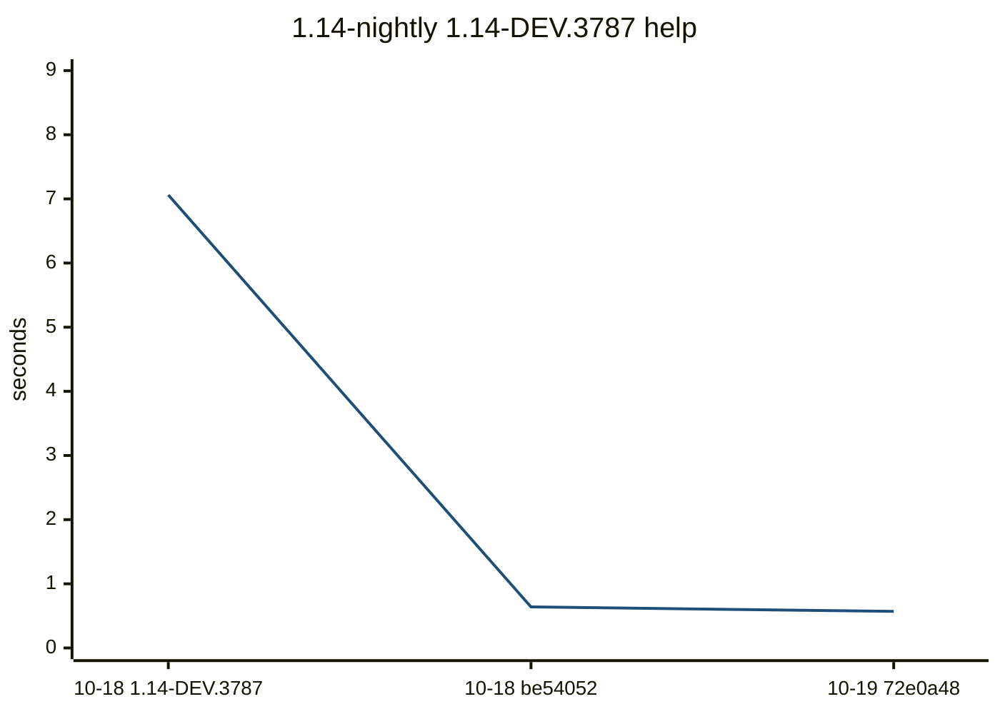
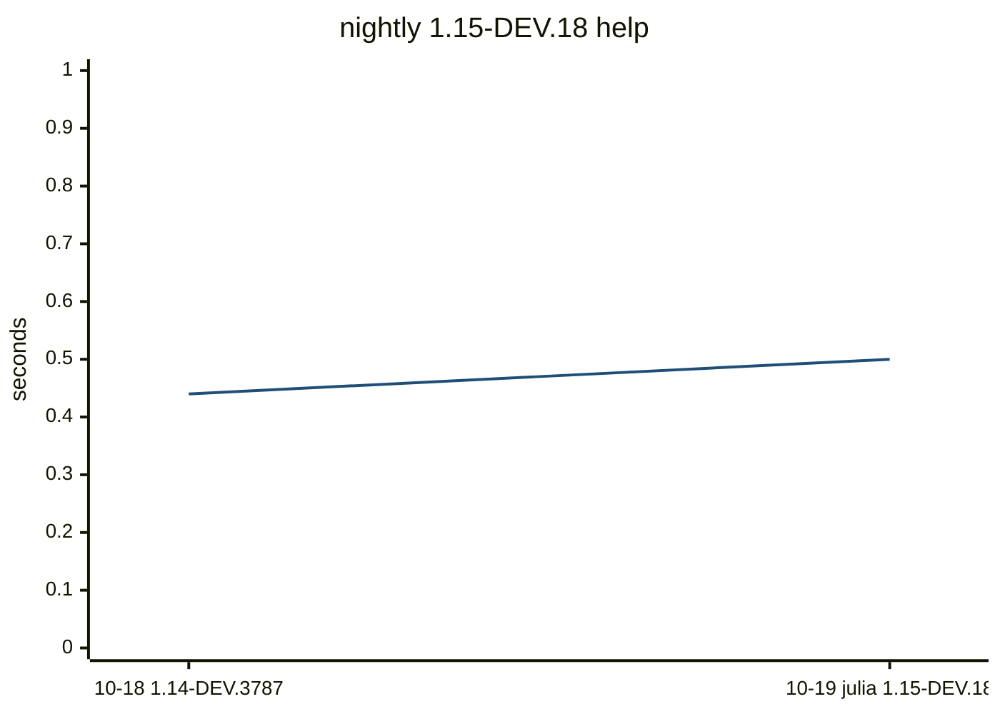
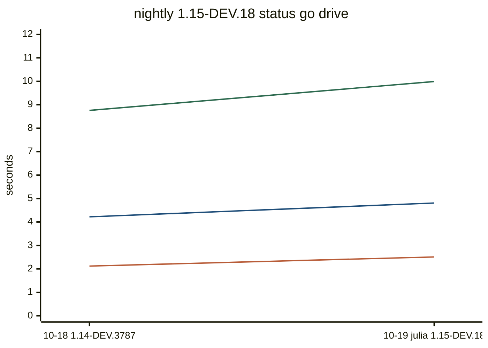

# Compile bench

Precompile time, load time, CLI wall time, `src/**/*.jl` size, and the host
(OS name, arch, CPU). `code lines` skips blank lines. A row is flagged when,
against the previous sample on the same Julia slot, the host OS or arch
changes, the Julia version changes, package precompile grows by 1.5x and 0.5s, a command wall grows
by 1.5x and 1s, or a method of at least 200 ms is new in the top 20 or
doubles. This does not fail CI.

## Flagged

- nightly: julia 1.14.0-DEV.3787 -> 1.15.0-DEV.18

## 1.13

| date | commit | version | julia | os | arch | src files | code lines | full s | pkg s | using s | help s | status s | go s | drive s |
| --- | --- | --- | --- | --- | --- | --- | --- | --- | --- | --- | --- | --- | --- | --- |
| 2026-10-18 | 81ff9d1 | 0.10.2 | 1.13.2 | Ubuntu 24.04.5 LTS | x86_64 | 1 | 407 | 9.21 | 1.02 | 0.32 | 15.61 | 16.38 |  |  |
| 2026-10-18 | be54052 | 0.10.2 | 1.13.2 | Ubuntu 24.04.5 LTS | x86_64 | 1 | 410 | 6.13 | 0.8 | 0.25 | 0.63 | 11.52 | 6.25 | 22.36 |
| 2026-10-19 | 72e0a48 | 0.10.2 | 1.13.2 | Ubuntu 24.04.5 LTS | x86_64 | 1 | 410 | 9.34 | 1.05 | 0.32 | 0.82 | 14.84 | 7.81 | 27.68 |

```mermaid
---
config:
  theme: base
  themeVariables:
    xyChart:
      plotColorPalette: "#1f4e79"
  xyChart:
    xAxis:
      labelRotation: 45
---
xychart-beta
    title "1.13 help"
    x-axis ["10-18 81ff9d1", "10-18 be54052", "10-19 72e0a48"]
    y-axis "seconds" 0 --> 19
        line "help" [15.61, 0.63, 0.82]
```


```mermaid
---
config:
  theme: base
  themeVariables:
    xyChart:
      plotColorPalette: "#1f4e79, #b85c38, #2d6a4f"
  xyChart:
    xAxis:
      labelRotation: 45
---
xychart-beta
    title "1.13 status go drive"
    x-axis ["10-18 81ff9d1", "10-18 be54052", "10-19 72e0a48"]
    y-axis "seconds" 0 --> 34
        line "status" [16.38, 11.52, 14.84]
        line "go" [null, 6.25, 7.81]
        line "drive" [null, 22.36, 27.68]
```


Latest `help` methods:

| method | now ms | previous ms |
| --- | ---: | ---: |
| `Tuple{typeof(DistSSHKit.main), Array{String, 1}}` | 243.1 | 181.6 |
| `Tuple{typeof(DistSSHKit.print_kit_root_usage), Base.PipeEndpoint}` | 70.1 | 48.8 |
| `Tuple{Distributed.var"#start_gc_msgs_task##0#start_gc_msgs_task##1"}` | 16.7 | 13.1 |
| `Tuple{typeof(Base.should_use_main_entrypoint)}` | 11.2 | 10.5 |
| `Tuple{typeof(Base.something), Nothing, Symbol}` | 3.3 | 3.4 |
| `Tuple{typeof(Base.getproperty), Base.GenericCondition{Base.ReentrantLock}, Symbol}` | 3.1 | 2.7 |

Latest `status` methods:

| method | now ms | previous ms |
| --- | ---: | ---: |
| `Tuple{typeof(DistSSHQueue.main), Array{String, 1}}` | 13595.1 | 10493.2 |
| `Tuple{DistSSHQueue.var"##show_status#192", Base.PipeEndpoint, Nothing, Bool, Nothing, Bool...` | 601.5 | 419.2 |
| `Tuple{typeof(DistSSHKit.main), Array{String, 1}}` | 254.1 | 187.5 |
| `Tuple{Distributed.var"#start_gc_msgs_task##0#start_gc_msgs_task##1"}` | 17.8 | 16.3 |
| `Tuple{typeof(Base.should_use_main_entrypoint)}` | 11.4 | 10.6 |
| `Tuple{typeof(Core.kwcall), NamedTuple{(:quiet, :tail, :verbose), Tuple{Bool, Nothing, Bool...` | 6.6 | 6.0 |
| `Tuple{typeof(Base._array_for), Type{DistSSHQueue.Job}, Array{Any, 1}, Base.HasShape{1}}` | 6.5 | 6.6 |
| `Tuple{typeof(Base.getproperty), Base.Order.By{DistSSHQueue.var"#sorted_kit_ssh_names##0#so...` | 5.8 | 5.4 |
| `Tuple{typeof(Base.getproperty), Base.Generator{Base.Pairs{Symbol, Union{}, Nothing, NamedT...` | 5.6 | 5.9 |
| `Tuple{typeof(Base.getproperty), NamedTuple{(:quiet, :progress, :verbose, :yes, :hosts_file...` | 5.6 | 5.8 |

Latest `go` methods:

| method | now ms | previous ms |
| --- | ---: | ---: |
| `Tuple{typeof(Core.kwcall), NamedTuple{(:project, :quiet, :verbosity, :yes, :sync, :args, :...` | 3158.0 | 1866.8 |
| `Tuple{typeof(Main.go_main)}` | 2070.3 | 1331.6 |
| `Tuple{DistSSHRun.var"#_go_run!##6#_go_run!##7"{String, String, Bool, Array{String, 1}, Not...` | 483.1 | 309.3 |
| `Tuple{typeof(DistSSHKit.main), Array{String, 1}}` | 251.6 | 186.3 |
| `Tuple{DistSSHRun.var"#577#578", Array{String, 1}}` | 126.3 |  |
| `Tuple{typeof(Base.JuliaSyntax.core_parser_hook), Core.SimpleVector, String, Int64, Int64, ...` | 121.4 | 84.4 |
| `Tuple{typeof(Base.push_widen), Array{NamedTuple{(:event, :kind, :job, :label, :total, :don...` | 118.2 | 98.8 |
| `Tuple{typeof(DistSSHRun.main), Array{String, 1}}` | 65.9 | 1083.0 |
| `Tuple{typeof(Core.kwcall), NamedTuple{(:ok, :footer), Tuple{Bool, String}}, typeof(DistSSH...` | 63.8 | 60.6 |
| `Tuple{typeof(Base.addenv), Base.Cmd, Pair{String, String}}` | 61.9 | 50.0 |

Latest `drive` methods:

| method | now ms | previous ms |
| --- | ---: | ---: |
| `Tuple{typeof(Core.kwcall), NamedTuple{(:original_args, :project_root), Tuple{Array{String,...` | 8162.1 | 5793.8 |
| `Tuple{typeof(Main.drive_main)}` | 2768.9 | 1687.1 |
| `Tuple{Distributed.var"#process_messages##0#process_messages##1"{Sockets.TCPSocket, Sockets...` | 1251.9 | 938.8 |
| `Tuple{Distributed.var"#39#40"{Distributed.LocalManager, Array{Int64, 1}, Distributed.Worke...` | 1029.5 | 788.1 |
| `Tuple{typeof(Serialization.serialize), Distributed.ClusterSerializer{Sockets.TCPSocket}, A...` | 492.2 | 369.9 |
| `Tuple{typeof(Base.print), Base.PipeEndpoint, Array{Int64, 1}, String}` | 297.5 | 231.7 |
| `Tuple{typeof(DistSSHKit.main), Array{String, 1}}` | 267.6 | 184.8 |
| `Tuple{typeof(Serialization.deserialize), Distributed.ClusterSerializer{Sockets.TCPSocket},...` | 182.0 | 140.7 |
| `Tuple{typeof(DistSSHKit.main)}` | 178.1 | 180.7 |
| `Tuple{Distributed.var"#35#36"{Distributed.LocalManager, Base.GenericCondition{Base.AlwaysL...` | 153.6 | 117.7 |

## 1.14-nightly

| date | commit | version | julia | os | arch | src files | code lines | full s | pkg s | using s | help s | status s | go s | drive s |
| --- | --- | --- | --- | --- | --- | --- | --- | --- | --- | --- | --- | --- | --- | --- |
| 2026-10-18 | 81ff9d1 | 0.10.2 | 1.14.0-DEV.3787 | Ubuntu 24.04.5 LTS | x86_64 | 1 | 407 | 8.48 | 0.91 | 0.35 | 7.06 | 7.15 |  |  |
| 2026-10-18 | be54052 | 0.10.2 | 1.14.0-DEV.3787 | Ubuntu 24.04.5 LTS | x86_64 | 1 | 410 | 7.48 | 0.88 | 0.34 | 0.64 | 6.63 | 3.29 | 12.38 |
| 2026-10-19 | 72e0a48 | 0.10.2 | 1.14.0-DEV.3787 | Ubuntu 24.04.5 LTS | x86_64 | 1 | 410 | 6.69 | 0.77 | 0.32 | 0.57 | 6.14 | 3.09 | 12.02 |




```mermaid
---
config:
  theme: base
  themeVariables:
    xyChart:
      plotColorPalette: "#1f4e79, #b85c38, #2d6a4f"
  xyChart:
    xAxis:
      labelRotation: 45
---
xychart-beta
    title "1.14-nightly 1.14-DEV.3787 status go drive"
    x-axis ["10-18 1.14-DEV.3787", "10-18 be54052", "10-19 72e0a48"]
    y-axis "seconds" 0 --> 15
        line "status" [7.15, 6.63, 6.14]
        line "go" [null, 3.29, 3.09]
        line "drive" [null, 12.38, 12.02]
```


Latest `help` methods:

| method | now ms | previous ms |
| --- | ---: | ---: |
| `Tuple{typeof(DistSSHKit.main), Array{String, 1}}` | 220.0 | 228.2 |
| `Tuple{typeof(DistSSHKit.print_kit_root_usage), Base.PipeEndpoint}` | 64.8 | 73.9 |
| `Tuple{typeof(Distributed.flush_gc_msgs)}` | 18.8 | 20.8 |
| `Tuple{typeof(Base.should_use_main_entrypoint)}` | 16.7 | 16.9 |
| `Tuple{Distributed.var"#start_gc_msgs_task##0#start_gc_msgs_task##1"}` | 11.7 | 14.5 |
| `Tuple{typeof(Base.string), Char}` | 6.0 | 6.9 |
| `Tuple{typeof(Base.tail), NTuple{14, String}}` | 4.5 | 5.1 |
| `Tuple{typeof(Base.tail), NTuple{13, String}}` | 4.0 | 4.7 |
| `Tuple{typeof(Base.tail), NTuple{12, String}}` | 3.6 | 4.5 |

Latest `status` methods:

| method | now ms | previous ms |
| --- | ---: | ---: |
| `Tuple{typeof(DistSSHQueue.main), Array{String, 1}}` | 13499.5 | 14927.6 |
| `Tuple{DistSSHQueue.var"##show_status#192", Base.PipeEndpoint, Nothing, Bool, Nothing, Bool...` | 450.6 | 505.4 |
| `Tuple{typeof(DistSSHKit.main), Array{String, 1}}` | 80.7 | 98.9 |
| `Tuple{typeof(Distributed.flush_gc_msgs)}` | 20.4 | 21.5 |
| `Tuple{Distributed.var"#start_gc_msgs_task##0#start_gc_msgs_task##1"}` | 12.9 | 14.0 |
| `Tuple{typeof(Core.kwcall), NamedTuple{(:quiet, :tail, :verbose), Tuple{Bool, Nothing, Bool...` | 10.2 | 11.8 |
| `Tuple{typeof(Base.getproperty), NamedTuple{(:quiet, :progress, :verbose, :yes, :hosts_file...` | 9.4 | 9.5 |
| `Tuple{typeof(DistSSHRun.DistSSHBase.format_placement_token), Symbol, String, Nothing}` | 8.0 | 9.6 |
| `Tuple{typeof(Base._array_for), Core.TypeEgal{DistSSHQueue.Job}, Array{Any, 1}, Base.HasSha...` | 6.7 | 7.4 |
| `Tuple{typeof(Base.getproperty), Base.Order.By{DistSSHQueue.var"#sorted_kit_ssh_names##0#so...` | 5.9 | 6.0 |

Latest `go` methods:

| method | now ms | previous ms |
| --- | ---: | ---: |
| `Tuple{typeof(Core.kwcall), NamedTuple{(:project, :quiet, :verbosity, :yes, :sync, :args, :...` | 2782.8 | 2521.5 |
| `Tuple{typeof(Main.go_main)}` | 1842.4 | 1609.9 |
| `Tuple{DistSSHRun.var"#_go_run!##6#_go_run!##7"{String, String, Bool, Array{String, 1}, Not...` | 362.9 | 325.2 |
| `Tuple{typeof(Base.push_widen), Array{NamedTuple{(:event, :kind, :job, :label, :total, :don...` | 117.6 | 129.5 |
| `Tuple{typeof(DistSSHKit.main), Array{String, 1}}` | 94.8 | 98.2 |
| `Tuple{DistSSHRun.var"#577#578", Array{String, 1}}` | 83.4 |  |
| `Tuple{typeof(DistSSHRun.main), Array{String, 1}}` | 60.0 | 1260.7 |
| `Tuple{typeof(Core.kwcall), NamedTuple{(:ok, :footer), Tuple{Bool, String}}, typeof(DistSSH...` | 52.9 | 57.8 |
| `Tuple{typeof(Base.addenv), Base.Cmd, Pair{String, String}}` | 45.4 | 51.2 |
| `Tuple{typeof(Base.grow_to!), Array{NamedTuple{(:event, :kind, :job, :label, :total, :done,...` | 36.1 | 39.7 |

Latest `drive` methods:

| method | now ms | previous ms |
| --- | ---: | ---: |
| `Tuple{typeof(Core.kwcall), NamedTuple{(:original_args, :project_root), Tuple{Array{String,...` | 6532.7 | 6631.9 |
| `Tuple{typeof(Main.drive_main)}` | 3136.8 | 3140.0 |
| `Tuple{Distributed.var"#38#39"{Distributed.LocalManager, Array{Int64, 1}, Distributed.Worke...` | 1050.4 | 943.2 |
| `Tuple{Distributed.var"#process_messages##0#process_messages##1"{Sockets.TCPSocket, Sockets...` | 874.6 | 1048.0 |
| `Tuple{typeof(Serialization.serialize), Distributed.ClusterSerializer{Sockets.TCPSocket}, A...` | 391.0 | 433.4 |
| `Tuple{typeof(Distributed.send_connection_hdr), Sockets.TCPSocket, Bool}` | 237.3 | 183.5 |
| `Tuple{typeof(Distributed.read_worker_host_port), Base.PipeEndpoint}` | 203.6 | 152.0 |
| `Tuple{typeof(DistSSHKit.main)}` | 201.7 | 216.0 |
| `Tuple{typeof(Distributed.write_msg), Sockets.TCPSocket, Distributed.ClusterSerializer{Sock...` | 154.1 |  |
| `Tuple{typeof(Base.print), Base.PipeEndpoint, Array{Int64, 1}, String}` | 151.7 | 165.0 |

## nightly

| date | commit | version | julia | os | arch | src files | code lines | full s | pkg s | using s | help s | status s | go s | drive s |
| --- | --- | --- | --- | --- | --- | --- | --- | --- | --- | --- | --- | --- | --- | --- |
| 2026-10-18 | be54052 | 0.10.2 | 1.14.0-DEV.3787 | Ubuntu 24.04.5 LTS | x86_64 | 1 | 410 | 5.15 | 0.68 | 0.23 | 0.44 | 4.22 | 2.12 | 8.76 |
| 2026-10-19 | 72e0a48 | 0.10.2 | 1.15.0-DEV.18 | Ubuntu 24.04.5 LTS | x86_64 | 1 | 410 | 5.95 | 0.71 | 0.26 | 0.5 | 4.81 | 2.51 | 9.99 |







Latest `help` methods:

| method | now ms | previous ms |
| --- | ---: | ---: |
| `Tuple{typeof(DistSSHKit.main), Array{String, 1}}` | 188.1 | 164.7 |
| `Tuple{typeof(DistSSHKit.print_kit_root_usage), Base.PipeEndpoint}` | 56.6 | 50.0 |
| `Tuple{typeof(Distributed.flush_gc_msgs)}` | 17.9 | 14.7 |
| `Tuple{Distributed.var"#start_gc_msgs_task##0#start_gc_msgs_task##1"}` | 12.2 | 9.6 |
| `Tuple{typeof(Base.should_use_main_entrypoint)}` | 12.2 | 10.5 |
| `Tuple{typeof(Base.string), Char}` | 6.2 | 5.7 |
| `Tuple{typeof(Base.tail), NTuple{14, String}}` | 5.6 | 4.8 |
| `Tuple{typeof(Base.tail), NTuple{13, String}}` | 4.5 | 3.4 |
| `Tuple{typeof(Base.tail), NTuple{12, String}}` | 4.0 | 2.9 |

Latest `status` methods:

| method | now ms | previous ms |
| --- | ---: | ---: |
| `Tuple{typeof(DistSSHQueue.main), Array{String, 1}}` | 11407.7 | 9722.1 |
| `Tuple{DistSSHQueue.var"##show_status#192", Base.PipeEndpoint, Nothing, Bool, Nothing, Bool...` | 367.9 | 319.6 |
| `Tuple{typeof(DistSSHKit.main), Array{String, 1}}` | 79.5 | 74.8 |
| `Tuple{typeof(Distributed.flush_gc_msgs)}` | 17.8 | 15.5 |
| `Tuple{Distributed.var"#start_gc_msgs_task##0#start_gc_msgs_task##1"}` | 12.0 | 10.4 |
| `Tuple{typeof(Core.kwcall), NamedTuple{(:quiet, :tail, :verbose), Tuple{Bool, Nothing, Bool...` | 10.3 | 8.4 |
| `Tuple{typeof(Base.getproperty), NamedTuple{(:quiet, :progress, :verbose, :yes, :hosts_file...` | 8.3 | 7.9 |
| `Tuple{typeof(DistSSHRun.DistSSHBase.format_placement_token), Symbol, String, Nothing}` | 8.0 | 7.9 |
| `Tuple{typeof(Base._array_for), Core.TypeEgal{DistSSHQueue.Job}, Array{Any, 1}, Base.HasSha...` | 7.2 | 5.8 |
| `Tuple{typeof(Base.getproperty), Base.Generator{Tuple{String, String, String}, DistSSHRun.v...` | 7.1 | 5.0 |

Latest `go` methods:

| method | now ms | previous ms |
| --- | ---: | ---: |
| `Tuple{typeof(Core.kwcall), NamedTuple{(:project, :quiet, :verbosity, :yes, :sync, :args, :...` | 2385.7 | 1560.6 |
| `Tuple{typeof(Main.go_main)}` | 1503.5 | 1104.0 |
| `Tuple{DistSSHRun.var"#_go_run!##6#_go_run!##7"{String, String, Bool, Array{String, 1}, Not...` | 289.5 | 214.9 |
| `Tuple{typeof(Base.push_widen), Array{NamedTuple{(:event, :kind, :job, :label, :total, :don...` | 96.1 | 83.8 |
| `Tuple{typeof(DistSSHKit.main), Array{String, 1}}` | 80.6 | 70.7 |
| `Tuple{DistSSHRun.var"#577#578", Array{String, 1}}` | 68.9 |  |
| `Tuple{typeof(DistSSHRun.main), Array{String, 1}}` | 49.9 | 806.7 |
| `Tuple{typeof(Core.kwcall), NamedTuple{(:ok, :footer), Tuple{Bool, String}}, typeof(DistSSH...` | 44.4 | 38.0 |
| `Tuple{typeof(Base.addenv), Base.Cmd, Pair{String, String}}` | 39.0 | 34.2 |
| `Tuple{typeof(Core.kwcall), NamedTuple{(:kind,), Tuple{Symbol}}, typeof(DistSSHRun.execute_...` | 31.6 | 26.9 |

Latest `drive` methods:

| method | now ms | previous ms |
| --- | ---: | ---: |
| `Tuple{typeof(Core.kwcall), NamedTuple{(:original_args, :project_root), Tuple{Array{String,...` | 5548.7 | 4262.9 |
| `Tuple{typeof(Main.drive_main)}` | 2485.3 | 2110.0 |
| `Tuple{Distributed.var"#38#39"{Distributed.LocalManager, Array{Int64, 1}, Distributed.Worke...` | 911.7 | 787.5 |
| `Tuple{Distributed.var"#process_messages##0#process_messages##1"{Sockets.TCPSocket, Sockets...` | 708.8 | 633.7 |
| `Tuple{typeof(Serialization.serialize), Distributed.ClusterSerializer{Sockets.TCPSocket}, A...` | 408.3 | 291.2 |
| `Tuple{typeof(Distributed.send_connection_hdr), Sockets.TCPSocket, Bool}` | 185.3 | 227.2 |
| `Tuple{typeof(Distributed.read_worker_host_port), Base.PipeEndpoint}` | 167.9 | 155.8 |
| `Tuple{typeof(DistSSHKit.main)}` | 151.0 | 132.3 |
| `Tuple{typeof(Base.print), Base.PipeEndpoint, Array{Int64, 1}, String}` | 135.0 | 110.4 |
| `Tuple{typeof(Serialization.deserialize), Distributed.ClusterSerializer{Sockets.TCPSocket},...` | 112.2 | 95.2 |

