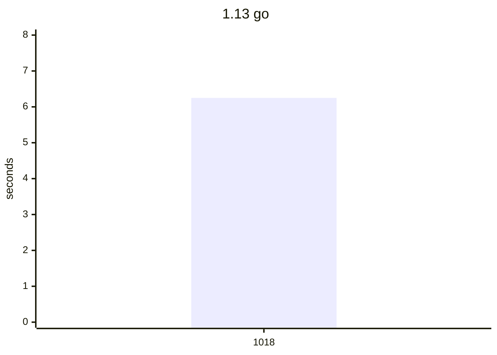
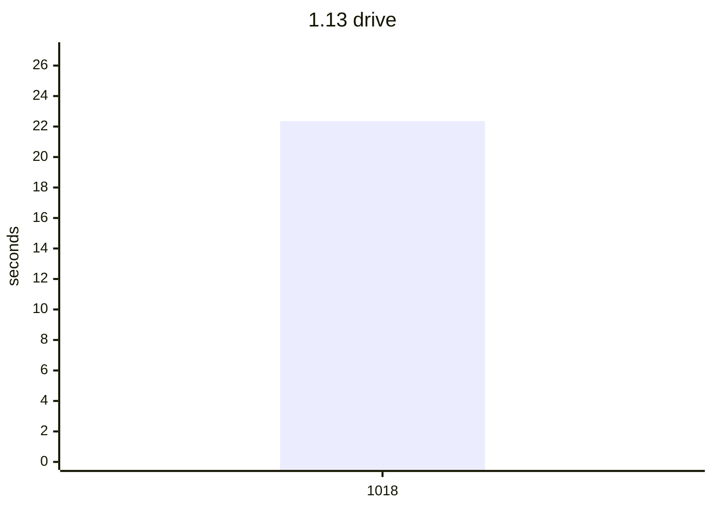
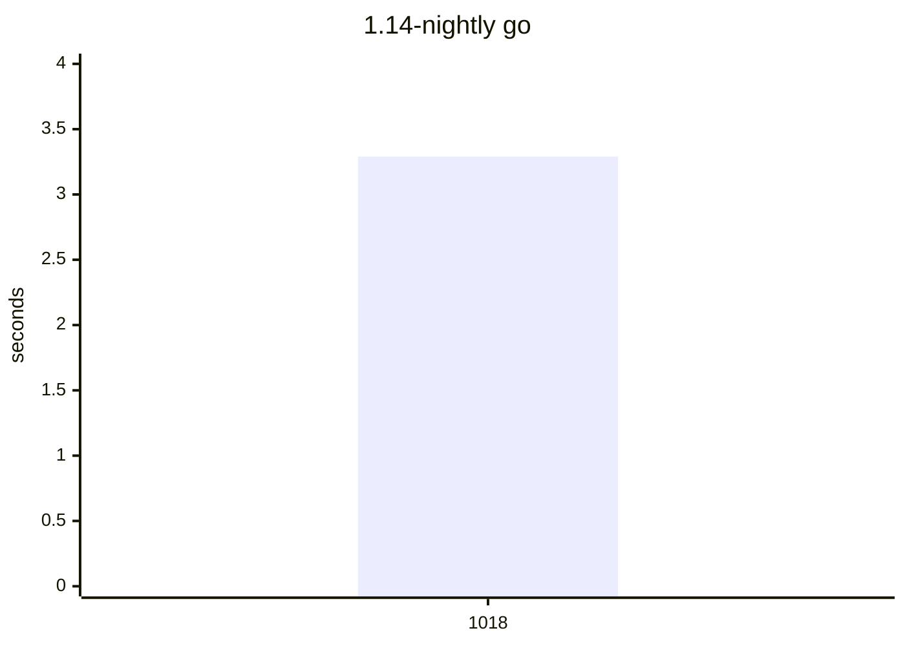
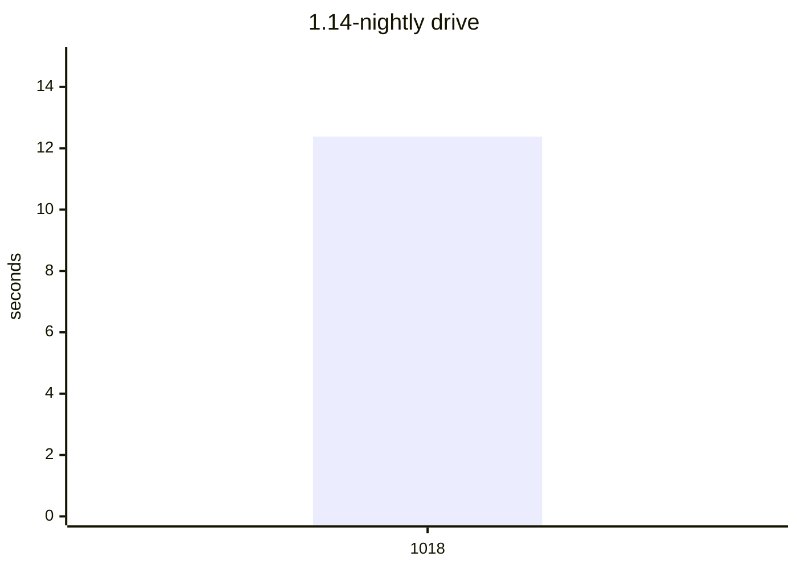
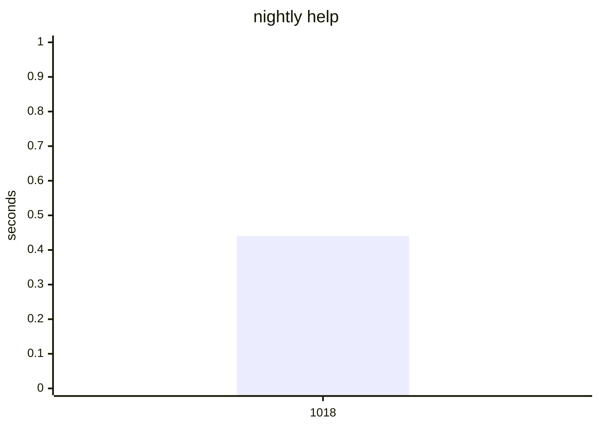
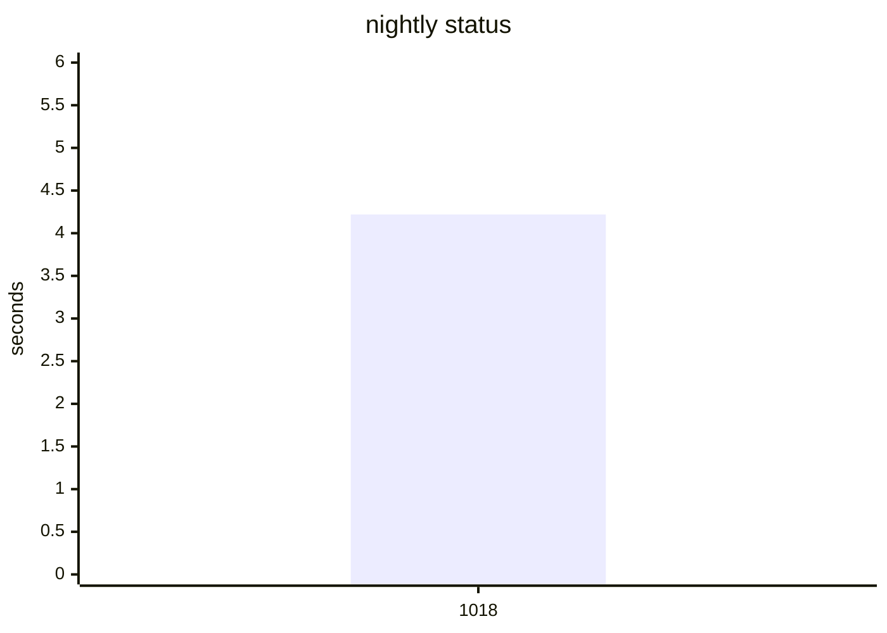
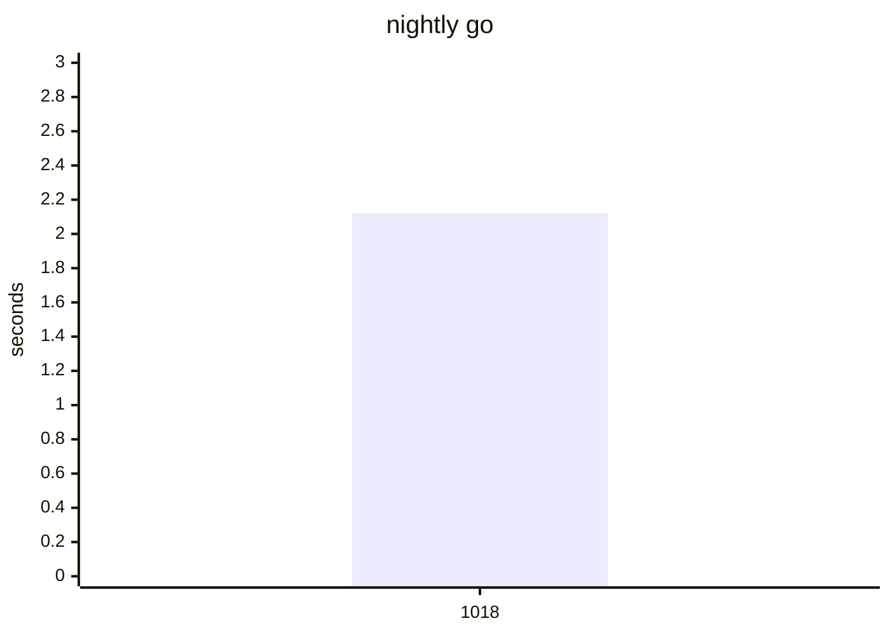
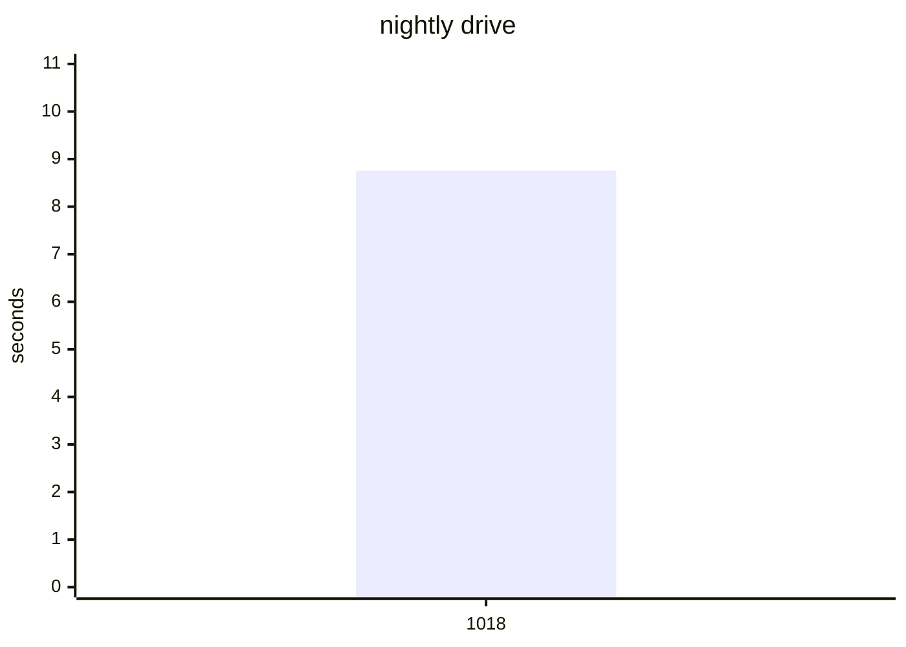

# Compile bench

Precompile time, load time, CLI wall time, `src/**/*.jl` size, and the host
(OS name, arch, CPU). `code lines` skips blank lines. A row is flagged when,
against the previous sample on the same Julia slot, the host OS or arch
changes, package precompile grows by 1.5x and 0.5s, a command wall grows
by 1.5x and 1s, or a method of at least 200 ms is new in the top 20 or
doubles. This does not fail CI.

## Flagged

- 1.13: status method new -> 10493.2 ms: Tuple{typeof(DistSSHQueue.main), Array{String, 1}}
- 1.14-nightly: status method new -> 14927.6 ms: Tuple{typeof(DistSSHQueue.main), Array{String, 1}}

## 1.13

| date | commit | version | os | arch | src files | code lines | full s | pkg s | using s | help s | status s | go s | drive s |
| --- | --- | --- | --- | --- | --- | --- | --- | --- | --- | --- | --- | --- | --- |
| 2026-10-18 | 81ff9d1 | 0.10.2 | Ubuntu 24.04.5 LTS | x86_64 | 1 | 407 | 9.21 | 1.02 | 0.32 | 15.61 | 16.38 |  |  |
| 2026-10-18 | be54052 | 0.10.2 | Ubuntu 24.04.5 LTS | x86_64 | 1 | 410 | 6.13 | 0.8 | 0.25 | 0.63 | 11.52 | 6.25 | 22.36 |

```mermaid
xychart-beta
    title "1.13 help"
    x-axis ["1018", "1018"]
    y-axis "seconds" 0 --> 19
    line [15.61, 0.63]
```


Latest `help` methods:

| method | now ms | previous ms |
| --- | ---: | ---: |
| `Tuple{typeof(DistSSHKit.main), Array{String, 1}}` | 181.6 | 14966.0 |
| `Tuple{typeof(DistSSHKit.print_kit_root_usage), Base.PipeEndpoint}` | 48.8 | 74.5 |
| `Tuple{Distributed.var"#start_gc_msgs_task##0#start_gc_msgs_task##1"}` | 13.1 | 17.8 |
| `Tuple{typeof(Base.should_use_main_entrypoint)}` | 10.5 | 11.3 |
| `Tuple{typeof(Base.something), Nothing, Symbol}` | 3.4 |  |
| `Tuple{typeof(Base.getproperty), Base.GenericCondition{Base.ReentrantLock}, Symbol}` | 2.7 |  |

```mermaid
xychart-beta
    title "1.13 status"
    x-axis ["1018", "1018"]
    y-axis "seconds" 0 --> 20
    line [16.38, 11.52]
```


Latest `status` methods:

| method | now ms | previous ms |
| --- | ---: | ---: |
| `Tuple{typeof(DistSSHQueue.main), Array{String, 1}}` | 10493.2 |  |
| `Tuple{DistSSHQueue.var"##show_status#192", Base.PipeEndpoint, Nothing, Bool, Nothing, Bool...` | 419.2 | 608.0 |
| `Tuple{typeof(DistSSHKit.main), Array{String, 1}}` | 187.5 | 15382.8 |
| `Tuple{Distributed.var"#start_gc_msgs_task##0#start_gc_msgs_task##1"}` | 16.3 | 17.8 |
| `Tuple{typeof(Base.should_use_main_entrypoint)}` | 10.6 | 11.3 |
| `Tuple{typeof(Base._array_for), Type{DistSSHQueue.Job}, Array{Any, 1}, Base.HasShape{1}}` | 6.6 | 6.6 |
| `Tuple{typeof(Core.kwcall), NamedTuple{(:quiet, :tail, :verbose), Tuple{Bool, Nothing, Bool...` | 6.0 | 6.9 |
| `Tuple{typeof(Base.getproperty), Base.Generator{Base.Pairs{Symbol, Union{}, Nothing, NamedT...` | 5.9 | 5.5 |
| `Tuple{typeof(Base.getproperty), NamedTuple{(:quiet, :progress, :verbose, :yes, :hosts_file...` | 5.8 | 5.3 |
| `Tuple{typeof(Base.getproperty), Base.MappingRF{typeof(Base.Unicode.textwidth), typeof(Base...` | 5.5 | 4.9 |




Latest `go` methods:

| method | now ms | previous ms |
| --- | ---: | ---: |
| `Tuple{typeof(Core.kwcall), NamedTuple{(:project, :quiet, :verbosity, :yes, :sync, :args, :...` | 1866.8 |  |
| `Tuple{typeof(Main.go_main)}` | 1331.6 |  |
| `Tuple{typeof(DistSSHRun.main), Array{String, 1}}` | 1083.0 |  |
| `Tuple{DistSSHRun.var"#_go_run!##6#_go_run!##7"{String, String, Bool, Array{String, 1}, Not...` | 309.3 |  |
| `Tuple{typeof(DistSSHKit.main), Array{String, 1}}` | 186.3 |  |
| `Tuple{typeof(Base.push_widen), Array{NamedTuple{(:event, :kind, :job, :label, :total, :don...` | 98.8 |  |
| `Tuple{typeof(Base.JuliaSyntax.core_parser_hook), Core.SimpleVector, String, Int64, Int64, ...` | 84.4 |  |
| `Tuple{typeof(Base.grow_to!), Array{NamedTuple{(:event, :kind, :job, :label, :total, :done,...` | 80.9 |  |
| `Tuple{typeof(Core.kwcall), NamedTuple{(:ok, :footer), Tuple{Bool, String}}, typeof(DistSSH...` | 60.6 |  |
| `Tuple{typeof(Base.addenv), Base.Cmd, Pair{String, String}}` | 50.0 |  |




Latest `drive` methods:

| method | now ms | previous ms |
| --- | ---: | ---: |
| `Tuple{typeof(Core.kwcall), NamedTuple{(:original_args, :project_root), Tuple{Array{String,...` | 5793.8 |  |
| `Tuple{typeof(Main.drive_main)}` | 1687.1 |  |
| `Tuple{typeof(DistSSHRun.main), Array{String, 1}}` | 1008.2 |  |
| `Tuple{Distributed.var"#process_messages##0#process_messages##1"{Sockets.TCPSocket, Sockets...` | 938.8 |  |
| `Tuple{Distributed.var"#39#40"{Distributed.LocalManager, Array{Int64, 1}, Distributed.Worke...` | 788.1 |  |
| `Tuple{typeof(Serialization.serialize), Distributed.ClusterSerializer{Sockets.TCPSocket}, A...` | 369.9 |  |
| `Tuple{typeof(Base.print), Base.PipeEndpoint, Array{Int64, 1}, String}` | 231.7 |  |
| `Tuple{typeof(DistSSHKit.main), Array{String, 1}}` | 184.8 |  |
| `Tuple{typeof(DistSSHKit.main)}` | 180.7 |  |
| `Tuple{typeof(Serialization.deserialize), Distributed.ClusterSerializer{Sockets.TCPSocket},...` | 140.7 |  |

## 1.14-nightly

| date | commit | version | os | arch | src files | code lines | full s | pkg s | using s | help s | status s | go s | drive s |
| --- | --- | --- | --- | --- | --- | --- | --- | --- | --- | --- | --- | --- | --- |
| 2026-10-18 | 81ff9d1 | 0.10.2 | Ubuntu 24.04.5 LTS | x86_64 | 1 | 407 | 8.48 | 0.91 | 0.35 | 7.06 | 7.15 |  |  |
| 2026-10-18 | be54052 | 0.10.2 | Ubuntu 24.04.5 LTS | x86_64 | 1 | 410 | 7.48 | 0.88 | 0.34 | 0.64 | 6.63 | 3.29 | 12.38 |

```mermaid
xychart-beta
    title "1.14-nightly help"
    x-axis ["1018", "1018"]
    y-axis "seconds" 0 --> 9
    line [7.06, 0.64]
```


Latest `help` methods:

| method | now ms | previous ms |
| --- | ---: | ---: |
| `Tuple{typeof(DistSSHKit.main), Array{String, 1}}` | 228.2 | 17077.1 |
| `Tuple{typeof(DistSSHKit.print_kit_root_usage), Base.PipeEndpoint}` | 73.9 | 87.4 |
| `Tuple{typeof(Distributed.flush_gc_msgs)}` | 20.8 | 23.7 |
| `Tuple{typeof(Base.should_use_main_entrypoint)}` | 16.9 | 13.7 |
| `Tuple{Distributed.var"#start_gc_msgs_task##0#start_gc_msgs_task##1"}` | 14.5 | 15.5 |
| `Tuple{typeof(Base.string), Char}` | 6.9 | 6.3 |
| `Tuple{typeof(Base.tail), NTuple{14, String}}` | 5.1 | 5.9 |
| `Tuple{typeof(Base.tail), NTuple{13, String}}` | 4.7 |  |
| `Tuple{typeof(Base.tail), NTuple{12, String}}` | 4.5 |  |

```mermaid
xychart-beta
    title "1.14-nightly status"
    x-axis ["1018", "1018"]
    y-axis "seconds" 0 --> 9
    line [7.15, 6.63]
```


Latest `status` methods:

| method | now ms | previous ms |
| --- | ---: | ---: |
| `Tuple{typeof(DistSSHQueue.main), Array{String, 1}}` | 14927.6 |  |
| `Tuple{DistSSHQueue.var"##show_status#192", Base.PipeEndpoint, Nothing, Bool, Nothing, Bool...` | 505.4 | 541.6 |
| `Tuple{typeof(DistSSHKit.main), Array{String, 1}}` | 98.9 | 6511.7 |
| `Tuple{typeof(Distributed.flush_gc_msgs)}` | 21.5 | 25.4 |
| `Tuple{Distributed.var"#start_gc_msgs_task##0#start_gc_msgs_task##1"}` | 14.0 | 14.7 |
| `Tuple{typeof(Core.kwcall), NamedTuple{(:quiet, :tail, :verbose), Tuple{Bool, Nothing, Bool...` | 11.8 | 13.5 |
| `Tuple{typeof(DistSSHRun.DistSSHBase.format_placement_token), Symbol, String, Nothing}` | 9.6 | 1.6 |
| `Tuple{typeof(Base.getproperty), NamedTuple{(:quiet, :progress, :verbose, :yes, :hosts_file...` | 9.5 | 1.4 |
| `Tuple{typeof(Base._array_for), Core.TypeEgal{DistSSHQueue.Job}, Array{Any, 1}, Base.HasSha...` | 7.4 | 7.1 |
| `Tuple{typeof(Base.getproperty), Base.Generator{Tuple{String, String, String}, DistSSHRun.v...` | 6.9 |  |




Latest `go` methods:

| method | now ms | previous ms |
| --- | ---: | ---: |
| `Tuple{typeof(Core.kwcall), NamedTuple{(:project, :quiet, :verbosity, :yes, :sync, :args, :...` | 2521.5 |  |
| `Tuple{typeof(Main.go_main)}` | 1609.9 |  |
| `Tuple{typeof(DistSSHRun.main), Array{String, 1}}` | 1260.7 |  |
| `Tuple{DistSSHRun.var"#_go_run!##6#_go_run!##7"{String, String, Bool, Array{String, 1}, Not...` | 325.2 |  |
| `Tuple{typeof(Base.push_widen), Array{NamedTuple{(:event, :kind, :job, :label, :total, :don...` | 129.5 |  |
| `Tuple{typeof(DistSSHKit.main), Array{String, 1}}` | 98.2 |  |
| `Tuple{typeof(Core.kwcall), NamedTuple{(:ok, :footer), Tuple{Bool, String}}, typeof(DistSSH...` | 57.8 |  |
| `Tuple{typeof(Base.addenv), Base.Cmd, Pair{String, String}}` | 51.2 |  |
| `Tuple{typeof(Base.grow_to!), Array{NamedTuple{(:event, :kind, :job, :label, :total, :done,...` | 39.7 |  |
| `Tuple{typeof(Base.grow_to!), Array{NamedTuple{(:event, :kind, :job, :label, :total, :done,...` | 39.1 |  |




Latest `drive` methods:

| method | now ms | previous ms |
| --- | ---: | ---: |
| `Tuple{typeof(Core.kwcall), NamedTuple{(:original_args, :project_root), Tuple{Array{String,...` | 6631.9 |  |
| `Tuple{typeof(Main.drive_main)}` | 3140.0 |  |
| `Tuple{Distributed.var"#process_messages##0#process_messages##1"{Sockets.TCPSocket, Sockets...` | 1048.0 |  |
| `Tuple{Distributed.var"#38#39"{Distributed.LocalManager, Array{Int64, 1}, Distributed.Worke...` | 943.2 |  |
| `Tuple{typeof(DistSSHRun.main), Array{String, 1}}` | 475.0 |  |
| `Tuple{typeof(Serialization.serialize), Distributed.ClusterSerializer{Sockets.TCPSocket}, A...` | 433.4 |  |
| `Tuple{typeof(DistSSHKit.main)}` | 216.0 |  |
| `Tuple{typeof(Distributed.send_connection_hdr), Sockets.TCPSocket, Bool}` | 183.5 |  |
| `Tuple{typeof(Base.print), Base.PipeEndpoint, Array{Int64, 1}, String}` | 165.0 |  |
| `Tuple{typeof(Distributed.read_worker_host_port), Base.PipeEndpoint}` | 152.0 |  |

## nightly

| date | commit | version | os | arch | src files | code lines | full s | pkg s | using s | help s | status s | go s | drive s |
| --- | --- | --- | --- | --- | --- | --- | --- | --- | --- | --- | --- | --- | --- |
| 2026-10-18 | be54052 | 0.10.2 | Ubuntu 24.04.5 LTS | x86_64 | 1 | 410 | 5.15 | 0.68 | 0.23 | 0.44 | 4.22 | 2.12 | 8.76 |




Latest `help` methods:

| method | now ms | previous ms |
| --- | ---: | ---: |
| `Tuple{typeof(DistSSHKit.main), Array{String, 1}}` | 164.7 |  |
| `Tuple{typeof(DistSSHKit.print_kit_root_usage), Base.PipeEndpoint}` | 50.0 |  |
| `Tuple{typeof(Distributed.flush_gc_msgs)}` | 14.7 |  |
| `Tuple{typeof(Base.should_use_main_entrypoint)}` | 10.5 |  |
| `Tuple{Distributed.var"#start_gc_msgs_task##0#start_gc_msgs_task##1"}` | 9.6 |  |
| `Tuple{typeof(Base.string), Char}` | 5.7 |  |
| `Tuple{typeof(Base.tail), NTuple{14, String}}` | 4.8 |  |
| `Tuple{typeof(Base.tail), NTuple{13, String}}` | 3.4 |  |
| `Tuple{typeof(Base.tail), NTuple{12, String}}` | 2.9 |  |




Latest `status` methods:

| method | now ms | previous ms |
| --- | ---: | ---: |
| `Tuple{typeof(DistSSHQueue.main), Array{String, 1}}` | 9722.1 |  |
| `Tuple{DistSSHQueue.var"##show_status#192", Base.PipeEndpoint, Nothing, Bool, Nothing, Bool...` | 319.6 |  |
| `Tuple{typeof(DistSSHKit.main), Array{String, 1}}` | 74.8 |  |
| `Tuple{typeof(Distributed.flush_gc_msgs)}` | 15.5 |  |
| `Tuple{Distributed.var"#start_gc_msgs_task##0#start_gc_msgs_task##1"}` | 10.4 |  |
| `Tuple{typeof(Core.kwcall), NamedTuple{(:quiet, :tail, :verbose), Tuple{Bool, Nothing, Bool...` | 8.4 |  |
| `Tuple{typeof(DistSSHRun.DistSSHBase.format_placement_token), Symbol, String, Nothing}` | 7.9 |  |
| `Tuple{typeof(Base.getproperty), NamedTuple{(:quiet, :progress, :verbose, :yes, :hosts_file...` | 7.9 |  |
| `Tuple{typeof(Base._array_for), Core.TypeEgal{DistSSHQueue.Job}, Array{Any, 1}, Base.HasSha...` | 5.8 |  |
| `Tuple{typeof(Base.getproperty), Base.MappingRF{DistSSHRun.var"#77#78", typeof(Base.max)}, ...` | 5.3 |  |




Latest `go` methods:

| method | now ms | previous ms |
| --- | ---: | ---: |
| `Tuple{typeof(Core.kwcall), NamedTuple{(:project, :quiet, :verbosity, :yes, :sync, :args, :...` | 1560.6 |  |
| `Tuple{typeof(Main.go_main)}` | 1104.0 |  |
| `Tuple{typeof(DistSSHRun.main), Array{String, 1}}` | 806.7 |  |
| `Tuple{DistSSHRun.var"#_go_run!##6#_go_run!##7"{String, String, Bool, Array{String, 1}, Not...` | 214.9 |  |
| `Tuple{typeof(Base.push_widen), Array{NamedTuple{(:event, :kind, :job, :label, :total, :don...` | 83.8 |  |
| `Tuple{typeof(DistSSHKit.main), Array{String, 1}}` | 70.7 |  |
| `Tuple{typeof(Core.kwcall), NamedTuple{(:ok, :footer), Tuple{Bool, String}}, typeof(DistSSH...` | 38.0 |  |
| `Tuple{typeof(Base.addenv), Base.Cmd, Pair{String, String}}` | 34.2 |  |
| `Tuple{typeof(Core.kwcall), NamedTuple{(:kind,), Tuple{Symbol}}, typeof(DistSSHRun.execute_...` | 26.9 |  |
| `Tuple{typeof(Base.grow_to!), Array{NamedTuple{(:event, :kind, :job, :label, :total, :done,...` | 25.7 |  |




Latest `drive` methods:

| method | now ms | previous ms |
| --- | ---: | ---: |
| `Tuple{typeof(Core.kwcall), NamedTuple{(:original_args, :project_root), Tuple{Array{String,...` | 4262.9 |  |
| `Tuple{typeof(Main.drive_main)}` | 2110.0 |  |
| `Tuple{Distributed.var"#38#39"{Distributed.LocalManager, Array{Int64, 1}, Distributed.Worke...` | 787.5 |  |
| `Tuple{Distributed.var"#process_messages##0#process_messages##1"{Sockets.TCPSocket, Sockets...` | 633.7 |  |
| `Tuple{typeof(DistSSHRun.main), Array{String, 1}}` | 304.8 |  |
| `Tuple{typeof(Serialization.serialize), Distributed.ClusterSerializer{Sockets.TCPSocket}, A...` | 291.2 |  |
| `Tuple{typeof(Distributed.send_connection_hdr), Sockets.TCPSocket, Bool}` | 227.2 |  |
| `Tuple{typeof(Distributed.read_worker_host_port), Base.PipeEndpoint}` | 155.8 |  |
| `Tuple{typeof(DistSSHKit.main)}` | 132.3 |  |
| `Tuple{Distributed.var"#remote##4#remote##5"{Distributed.var"#remote##6#remote##7"{Distribu...` | 116.2 |  |

