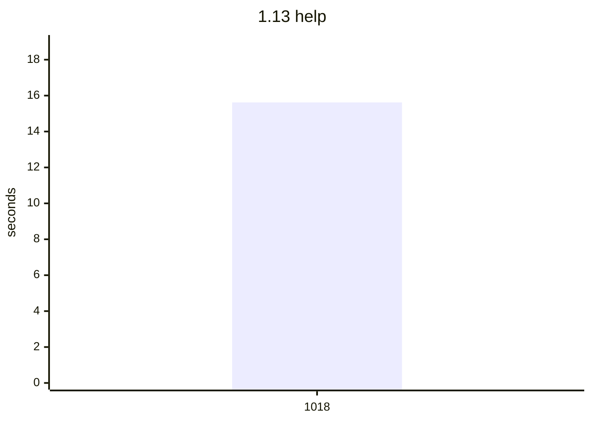
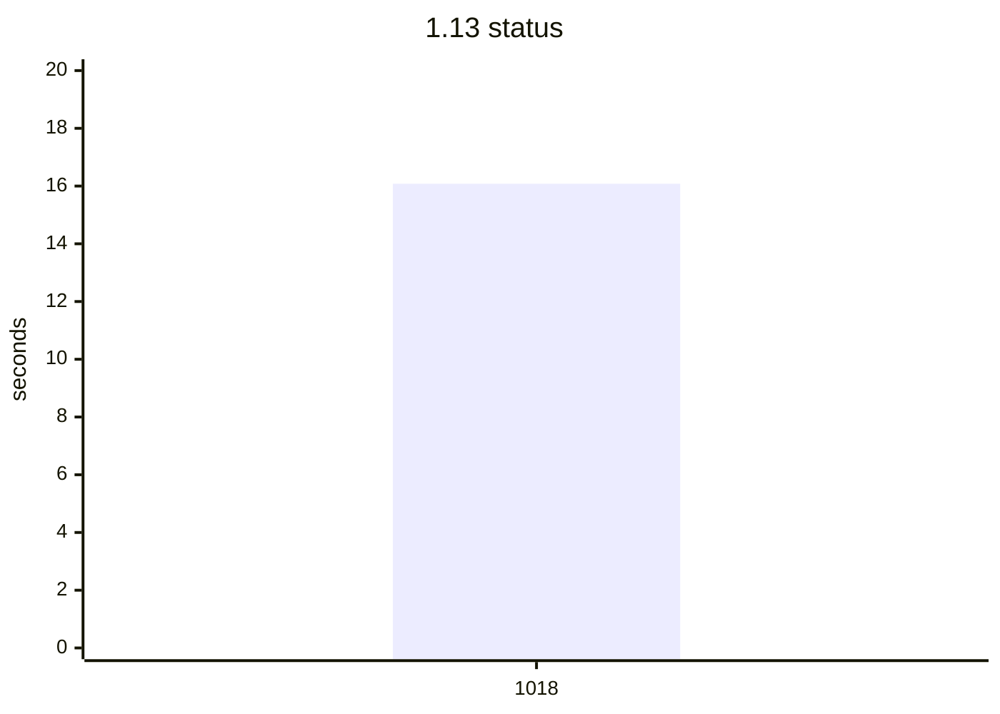

# Compile bench

Precompile time, load time, CLI wall time, `src/**/*.jl` size, and the host
(OS name, arch, CPU). `code lines` skips blank lines. A row is flagged when,
against the previous sample on the same Julia slot, the host OS or arch
changes, package precompile grows by 1.5x and 0.5s, a command wall grows
by 1.5x and 1s, or a method of at least 200 ms is new in the top 20 or
doubles. This does not fail CI.

## Flagged

No sample grew past the watch line.

## 1.13

| date | commit | version | os | arch | src files | code lines | full s | pkg s | using s | help s | status s |
| --- | --- | --- | --- | --- | --- | --- | --- | --- | --- | --- | --- |
| 2026-10-18 | 81ff9d1 | 0.10.2 | Ubuntu 24.04.5 LTS | x86_64 | 1 | 407 | 9.19 | 1.02 | 0.32 | 15.62 | 16.08 |

Latest `help` methods:

| method | now ms | previous ms |
| --- | ---: | ---: |
| `Tuple{typeof(DistSSHKit.main), Array{String, 1}}` | 15048.2 |  |
| `Tuple{typeof(DistSSHKit.print_kit_root_usage), Base.PipeEndpoint}` | 78.1 |  |
| `Tuple{Distributed.var"#start_gc_msgs_task##0#start_gc_msgs_task##1"}` | 18.6 |  |
| `Tuple{typeof(Base.should_use_main_entrypoint)}` | 11.2 |  |
| `Tuple{typeof(Base.in), String, Tuple{String, String, String}}` | 5.9 |  |
| `Tuple{typeof(Base.getproperty), Base.MappingRF{DistSSHRun.var"#67#68", typeof(Base.max)}, ...` | 5.6 |  |
| `Tuple{typeof(Base.getproperty), Base.Order.By{DistSSHQueue.var"#sorted_kit_ssh_names##0#so...` | 5.5 |  |
| `Tuple{typeof(Base.getproperty), Base.MappingRF{DistSSHRun.var"#77#78", typeof(Base.max)}, ...` | 5.4 |  |
| `Tuple{typeof(Base.getproperty), NamedTuple{(:quiet, :progress, :verbose, :yes, :hosts_file...` | 5.3 |  |
| `Tuple{typeof(Base.getproperty), Base.Generator{Base.Pairs{Symbol, Union{}, Nothing, NamedT...` | 5.2 |  |

Latest `status` methods:

| method | now ms | previous ms |
| --- | ---: | ---: |
| `Tuple{typeof(DistSSHKit.main), Array{String, 1}}` | 14893.7 |  |
| `Tuple{DistSSHQueue.var"##show_status#192", Base.PipeEndpoint, Nothing, Bool, Nothing, Bool...` | 606.4 |  |
| `Tuple{Distributed.var"#start_gc_msgs_task##0#start_gc_msgs_task##1"}` | 17.6 |  |
| `Tuple{typeof(Base.should_use_main_entrypoint)}` | 11.2 |  |
| `Tuple{typeof(Base._array_for), Type{DistSSHQueue.Job}, Array{Any, 1}, Base.HasShape{1}}` | 6.8 |  |
| `Tuple{typeof(Core.kwcall), NamedTuple{(:quiet, :tail, :verbose), Tuple{Bool, Nothing, Bool...` | 6.8 |  |
| `Tuple{typeof(Base.in), String, Tuple{String, String, String}}` | 5.8 |  |
| `Tuple{typeof(Base.getproperty), Base.MappingRF{DistSSHRun.var"#67#68", typeof(Base.max)}, ...` | 5.6 |  |
| `Tuple{typeof(Base.getproperty), Base.Order.By{DistSSHQueue.var"#sorted_kit_ssh_names##0#so...` | 5.5 |  |
| `Tuple{typeof(Base.getproperty), Base.MappingRF{DistSSHRun.var"#77#78", typeof(Base.max)}, ...` | 5.3 |  |

