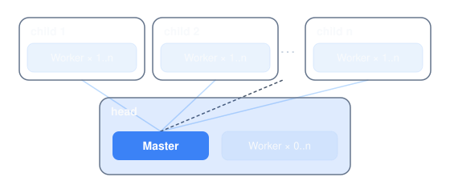

```@raw html
---
layout: home

hero:
  name: DistSSH
  text: Multi-machine Julia over SSH
  tagline: "DistSSHKit is the usual install and CLI (julia -m DistSSHKit). DistSSHRun and DistSSHQueue are separate packages with their own docs; Kit reexports them."
  actions:
    - theme: brand
      text: Requirements
      link: /requirements/
    - theme: brand
      text: User Guide
      link: /manual/
    - theme: alt
      text: API
      link: /api/
  image:
    src: /logo/logo-dynamic.svg
    dark: /logo/logo-dark-dynamic.svg
    alt: "DistSSHKit.jl logo"

features:
  - icon: 📦
    title: DistSSHKit.jl
    details: One command for local runs and queue client verbs. [User Guide](/manual/), [Prepare](/tutorial/prepare/), [API](/api/). Repository [yamanori99/DistSSHKit.jl](https://github.com/yamanori99/DistSSHKit.jl).
  - icon: 🖥️
    title: DistSSHRun.jl
    details: "setup, go, ride, drive, hostinfo, pool, and related helpers. Submodules DistSSHRun.DistSSHBase (host tokens, deploy) and DistSSHRun.DistSSHUp (Julia channel sync). Docs [yamanori99.github.io/DistSSHRun.jl/stable](https://yamanori99.github.io/DistSSHRun.jl/stable/). Repository [yamanori99/DistSSHRun.jl](https://github.com/yamanori99/DistSSHRun.jl)."
  - icon: 📋
    title: DistSSHQueue.jl
    details: "Leave jobs on a queue host (submit, status, fetch, serve, …). Reach it through Kit or julia -m DistSSHQueue. Manual on this site under [How it runs](/queue/). API docs [yamanori99.github.io/DistSSHQueue.jl/stable](https://yamanori99.github.io/DistSSHQueue.jl/stable/). Repository [yamanori99/DistSSHQueue.jl](https://github.com/yamanori99/DistSSHQueue.jl)."
---
```

# [DistSSHKit.jl](@id DistSSHKit.jl)

## Which package to use

| Goal | Package | How you run it | Docs on this site |
| --- | --- | --- | --- |
| Default install, notebooks, mixed local + queue client | **DistSSHKit** | `julia -m DistSSHKit` or `using DistSSHKit` | [Requirements](@ref), [User Guide](@ref Manual), [API](@ref API) |
| Run scripts on SSH hosts without queue features | **DistSSHRun** | `julia -m DistSSHRun` or `using DistSSHRun` | Same manual ([`setup`](@ref Manual-setup), [`go`](@ref Manual-go), …) — implemented in Run; linked from Kit |
| Queue host or queue-only embedding | **DistSSHQueue** | `julia -m DistSSHQueue` or `using DistSSHQueue` | [How it runs](@ref Queue-manual), [First job](@ref Queue-Tutorial-Client) |
| Host tokens, ship/rsync deploy, `up` channel sync | **DistSSHRun.DistSSHBase**, **DistSSHRun.DistSSHUp** | Submodules of DistSSHRun (not separate registered packages) | [setup](@ref Manual-setup), [up](@ref Manual-up), [API](@ref API) |

Quick install (Julia **1.13+** on macOS, Linux, or WSL2 Ubuntu):

```julia
pkg> add DistSSHKit
```

That pulls compatible **DistSSHRun** and **DistSSHQueue** versions. Host tools **`ssh`**, **`rsync`**, and **`git`** (git deploy only) are still required on the machine; see [Requirements](@ref).

DistSSHKit is a toolkit for running Julia computations across multiple
machines over SSH. It works equally well for a pair of workstations and
for a larger set of lab machines.
Supported on **macOS, Linux, and WSL2 Ubuntu** (not native Windows).

Install it with `pkg> add DistSSHKit` and use it through one command,
`julia -m DistSSHKit`.
[DistSSHRun](https://yamanori99.github.io/DistSSHRun.jl/stable/) and
[DistSSHQueue](https://yamanori99.github.io/DistSSHQueue.jl/stable/)
come with it, and you reach both through that command.

A job runs in one of two places.

- **This machine.** Start it here. The SSH connection stays open until
  it finishes.
- **Queue host.** An always-on machine. Leave the job there. Jobs run
  one at a time. A dropped laptop does not stop a job already left there.
  `qhost` names that machine.

**Prepare hosts** is shared by both. [`setup`](@ref Manual-setup) prepares
SSH hosts. [`up`](@ref Manual-up) puts the same Julia channel on each
machine. Do that before you start.

## What is DistSSHKit?

On this machine, three ways to run a script:

- **Same script on each machine** (`go`) — each host runs your `.jl` end to
  end. Prefer when every run is already a complete job.
- **Split map / filter** (`ride`) — experimental split of `map`, `filter`,
  and simple comprehensions.
- **One machine coordinates** (`drive`) — the main process farms work to
  the others
  ([Distributed.jl](https://docs.julialang.org/en/v1/manual/distributed-computing/)).

Match Julia versions with [`up`](@ref Manual-up) before you start. Remote
project setup, sync, and collecting outputs are the same from the terminal
or from Julia / notebooks.

Call paths:

- **Julia API** — `setup!` for remotes, `go!` / `drive!` to run, or
  `pipeline!` for optional sync → `drive!` → collect (not `setup!`;
  rsync there does not instantiate). Host facts are CLI `hostinfo`.
  Worker counts stay explicit `parent:N` / `child:NAME:N`.
- **CLI** — `julia --project=. -m DistSSHKit go …` / `ride …` / `drive …`
  (and `setup`, `hostinfo`, `pool`, `demo`, …)

All of these need **Julia 1.13+** ([Requirements](@ref)).

Same host tokens for setup / go / drive / ride / hostinfo / pool (`parent:2`,
`child:user@host:1`; setup / hostinfo / pool ignore `:N`). Details:
[API](@ref API), [User Guide](@ref Manual).

## Installation

From the Julia REPL, type `]` to enter the Pkg REPL mode and run:

```julia
pkg> add DistSSHKit
```

Or: `import Pkg; Pkg.add("DistSSHKit")`.

Also needs **`ssh`**, **`rsync`**, and **`git`** (git deploy only);
`pkg> add` does not install them. [Requirements](@ref).

## Basic terms

- **Host** — a machine, given as a token like `parent` or
  `child:user@hostname`.
- **Process** — one `julia` OS process with its own memory. A run may
  start several per host (Distributed.jl).
- **The machine the run starts from** — this machine when you run `go` /
  `drive` here, and the queue host when the job was left there.
- **Master** — the process on the machine the run starts from. It plans
  slots (`go`) or farms work to workers (`drive`) and collects results.
- **Worker** — a process that receives work from the master and runs it.

Example: running `go` / `drive` on your machine makes that machine the one
the job started from. Each host can run several workers (including zero
on this machine).
Remotes are optional.

```@raw html
<p style="text-align:center">


</p>
```

The diagram is **drive**. One master on the machine the run starts from,
workers on each host.
**go** uses the same host tokens, but there is no
master/worker: each host runs the script on its own.

```text
parent                 # this machine
parent:2               # two on this machine
child:user@hostname    # SSH child (user@host, IP, or Host alias)
child:user@hostname:4  # four on that child
```

No hard limit on SSH hosts; more remotes means more SSH and deploy time —
start with a few. Each SSH host needs:

- Passwordless SSH from the machine the run starts from
- Julia with the same major.minor version as that machine
  (`setup --check` verifies this). Match the channel with
  [`up`](@ref Manual-up) first.

Details: [Requirements](@ref).

## Next

Start at **[Requirements](@ref)**.

On this machine: **[Prepare](@ref Tutorial-Prepare)** and the bundled
**[Demo](@ref Tutorial-Demo)**, then [`setup`](@ref Manual-setup),
[`go`](@ref Manual-go), [`ride`](@ref Manual-ride), and
[`drive`](@ref Manual-drive).

On a queue host: **[Prepare the machine](@ref Queue-Tutorial-Prepare)**,
then **[First job](@ref Queue-Tutorial-Client)**.

Or the **[API](@ref API)** to embed from Julia. The rest of the
[User Guide](@ref Manual) lists every command.

## Contributing

Bugs and feature requests:
[Issues](https://github.com/yamanori99/DistSSHKit.jl/issues).
Questions and ideas:
[Discussions](https://github.com/yamanori99/DistSSHKit.jl/discussions).
See
[CONTRIBUTING.md](https://github.com/yamanori99/DistSSHKit.jl/blob/main/CONTRIBUTING.md)
for how to contribute.

## License

Source code is
[MIT](https://github.com/yamanori99/DistSSHKit.jl/blob/main/LICENSE).
