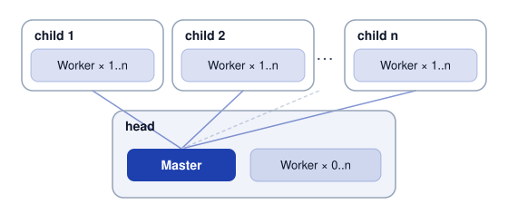

```@raw html
---
layout: home

hero:
  name: Multi-machine Julia over SSH
  text: DistSSHKit
  tagline: "Install DistSSHKit once, then drive everything with julia -m DistSSHKit — prepare SSH hosts, run while you stay connected, or leave jobs on a queue host."
  actions:
    - theme: brand
      text: Requirements
      link: /requirements/
    - theme: brand
      text: Prepare
      link: /tutorial/prepare/
    - theme: brand
      text: User Guide
      link: /manual/
    - theme: alt
      text: First queue job
      link: /tutorial/queue-client/
  image:
    src: /logo/logo-dynamic.svg
    dark: /logo/logo-dark-dynamic.svg
    alt: "DistSSHKit.jl logo"

features:
  - title: Prepare SSH hosts
    details: "Deploy your project and install deps on each remote before you run. Example: `julia --project=. -m DistSSHKit setup --rsync child:user@host` then `julia --project=. -m DistSSHKit setup --instantiate child:user@host`. Verify with `julia --project=. -m DistSSHKit setup --check child:user@host`. Walkthrough: [Prepare](/tutorial/prepare/) · Reference: [setup](/manual/setup/)."
  - title: Run a script from this machine
    details: "Start the job here; SSH stays open until every slot finishes. Example: `julia --project=. -m DistSSHKit go parent child:user@host SCRIPT.jl`. Try the bundled demos: [Demo](/tutorial/demo/) · Reference: [go](/manual/go/) (also [drive](/manual/drive/) and [ride](/manual/ride/))."
  - title: Leave a job on a queue host
    details: "Submit from your project directory; check and fetch later while your laptop is offline. Example: `julia --project=. -m DistSSHKit qhost:HOST submit go parent:1 SCRIPT.jl`, then `julia --project=. -m DistSSHKit qhost:HOST status` and `julia --project=. -m DistSSHKit qhost:HOST fetch <id>`. Path: [First job](/tutorial/queue-client/) · Reference: [How it runs](/queue/), [submit](/queue/submit/), [status](/queue/status/), [fetch](/queue/fetch/)."
---
```

# [DistSSHKit.jl](@id DistSSHKit.jl)

## Install

Julia **1.13+** on **macOS, Linux, or WSL2 Ubuntu** (not native Windows).

```julia
pkg> add DistSSHKit
```

Your machine also needs **`ssh`** and **`rsync`**, and **`git`** if you use git deploy — `pkg> add` does not install them. See [Requirements](@ref).

## How you operate it

DistSSHKit is one command, `julia -m DistSSHKit`, for everything on the home page tiles: host prep ([`setup`](@ref Manual-setup), [`up`](@ref Manual-up)), runs that start on **this machine** ([`go`](@ref Manual-go), [`drive`](@ref Manual-drive), [`ride`](@ref Manual-ride)), and client verbs toward an **always-on queue host** (`submit`, `status`, `fetch`, … — [How it runs](@ref Queue-manual)).

- **This machine** — the SSH session from your laptop (or login node) stays up until the job finishes.
- **Queue host** — you leave the job on another machine; jobs run one at a time there so you can disconnect. `qhost:` names that host on client commands.

**Prepare hosts** is shared: do [`setup`](@ref Manual-setup) (and match Julia with [`up`](@ref Manual-up)) before either path.

## Under the hood

`pkg> add DistSSHKit` pulls compatible **[DistSSHRun](https://yamanori99.github.io/DistSSHRun.jl/stable/)** and **[DistSSHQueue](https://yamanori99.github.io/DistSSHQueue.jl/stable/)**; you normally talk to both only through `julia -m DistSSHKit`. The step-by-step manual on **this site** is the Kit manual ([User Guide](@ref Manual)); Run and Queue also publish their own API references at the links above. Embedders who install Run or Queue without Kit: see [Package split](@ref Developers-package-split).

## What is DistSSHKit?

Same script, three run styles on this machine:

- **`go`** — each host runs the full script (default mental model).
- **`drive`** — one coordinator with [Distributed.jl](https://docs.julialang.org/en/v1/manual/distributed-computing/) workers.
- **`ride`** — experimental `map` / `filter` split.

Host tokens look like `parent:2`, `child:user@hostname:4`. [`hostinfo`](@ref Manual-hostinfo) and [`pool`](@ref Manual-pool) inspect machines before you pass tokens. More detail: [User Guide](@ref Manual), [API](@ref API).

## Basic terms

- **Host** — `parent` (this machine) or `child:user@hostname` (SSH).
- **Process** — one `julia` OS process; a run may start several per host.
- **Master / worker** — `drive` topology only; **`go`** has no master/worker split.

Example tokens:

```text
parent                 # this machine
parent:2               # two slots on this machine
child:user@hostname    # one slot on a remote
child:user@hostname:4  # four slots on that remote
```

Each SSH host needs passwordless SSH from where you start the run and a matching Julia **major.minor** ([`setup --check`](@ref Manual-setup), [`up`](@ref Manual-up)). More: [Requirements](@ref).

```@raw html
<p style="text-align:center">


</p>
```

The diagram is **`drive`**. **`go`** uses the same host tokens but each host runs the script independently.

## Next

1. [Requirements](@ref)
2. [Prepare](@ref Tutorial-Prepare) → [Demo](@ref Tutorial-Demo) → [`setup`](@ref Manual-setup) / [`go`](@ref Manual-go) / [`drive`](@ref Manual-drive)
3. Queue path: [Prepare the machine](@ref Queue-Tutorial-Prepare) → [First job](@ref Queue-Tutorial-Client)

## Contributing

Bugs and feature requests:
[Issues](https://github.com/yamanori99/DistSSHKit.jl/issues).
Questions:
[Discussions](https://github.com/yamanori99/DistSSHKit.jl/discussions).
[CONTRIBUTING.md](https://github.com/yamanori99/DistSSHKit.jl/blob/main/CONTRIBUTING.md).

## License

[MIT](https://github.com/yamanori99/DistSSHKit.jl/blob/main/LICENSE).